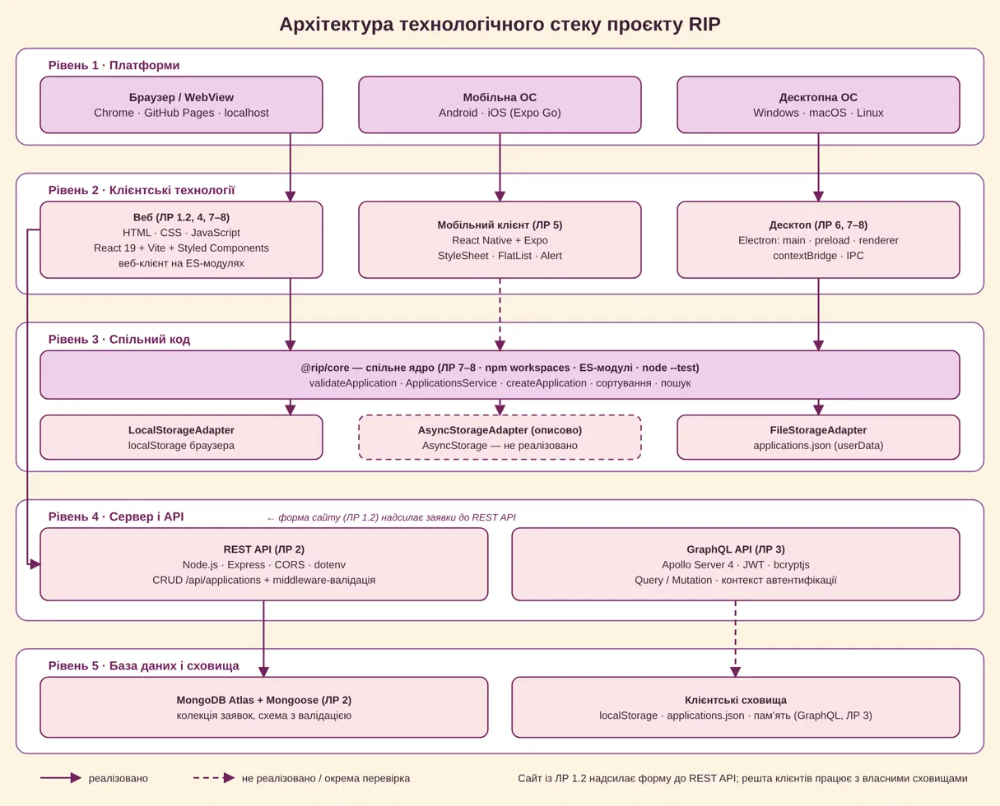

# RIP — крос-платформний застосунок для заявок на ритуальні послуги

Навчальний проєкт курсу «Крос-платформне програмування». **RIP** — агрегатор ритуальних послуг (абревіатура, а не «rest in peace»): людина залишає одну заявку замість десятка дзвінків до бюро, кладовищ і церков. У цьому монорепозиторії — спільне ядро та два клієнти, що працюють з однією бізнес-логікою.



## Швидкий старт

```bash
npm install            # з кореня, не з теки пакета
npm test               # тести всіх пакетів (51 тест)
npm run start:web      # http://localhost:3000  (інший порт: PORT=3100)
npm run start:desktop  # вікно Electron
```

## Технологічний стек і компетентності

### Стек за рівнями

| Рівень | Технології | Де в репозиторії |
|---|---|---|
| 1. Платформи | браузер / WebView, Android і iOS (Expo Go), Windows / macOS / Linux | — |
| 2. Клієнтські технології | HTML, CSS, JavaScript; React + Vite + Styled Components; React Native + Expo; Electron | [`packages/web`](packages/web), [`packages/desktop`](packages/desktop) |
| 3. Спільний код | JavaScript (ES-модулі), npm workspaces, адаптери збереження, `node --test` | [`packages/core`](packages/core) |
| 4. Сервер і API | Node.js, Express (REST); Apollo Server, GraphQL, JWT | окремі проєкти лабораторних робіт 2–3 |
| 5. База даних | MongoDB Atlas + Mongoose; localStorage; файл `applications.json` | [`LocalStorageAdapter`](packages/web/localStorageAdapter.js), [`FileStorageAdapter`](packages/desktop/fileStorageAdapter.js) |

У цьому репозиторії лежать рівні 2–3 (клієнти й ядро). Сервери (ЛР 2–3), React-застосунок (ЛР 4) і мобільний клієнт (ЛР 5) розроблялися в окремих теках проєкту курсу, тому тут вони не продубльовані.

### Що я знаю та вмію

- Розрізняю підходи до крос-платформності: WebView, нативна компіляція, спільний UI — і можу обґрунтувати вибір для конкретної задачі.
- Будую REST API (Express, Mongoose, валідація, CORS) і GraphQL API (схема, резолвери, JWT-автентифікація).
- Роблю SPA на React (хуки, стан, localStorage) та мобільний клієнт на React Native.
- Розумію архітектуру Electron: головний процес, рендер-процес, preload, `contextBridge`, IPC, налаштування безпеки вікна.
- Виділяю платформонезалежне ядро в окремий пакет, організовую монорепозиторій на npm workspaces і підключаю ядро до різних клієнтів через адаптери та впровадження залежностей.
- Покриваю спільну логіку автоматичними тестами без сторонніх бібліотек.

### Сильні моменти проєкту

1. **Одне ядро — два клієнти.** Правила перевірки заявки, сортування й пошук описано один раз у [`packages/core`](packages/core); зміна `MAX_COMMENT_LENGTH` чи тексту помилки одразу змінює поведінку і веб-, і десктопного клієнта без змін їхнього коду.
2. **Адаптери збереження.** Ядро знає лише інтерфейс `load()` / `save()`; [`LocalStorageAdapter`](packages/web/localStorageAdapter.js) і [`FileStorageAdapter`](packages/desktop/fileStorageAdapter.js) реалізують його для браузера й Electron.
3. **Безпечна архітектура Electron.** `contextIsolation`, `nodeIntegration: false`, Content-Security-Policy, preload з чотирма функціями (list, add, remove, toggle); логіку IPC винесено в [`ipcHandlers.js`](packages/desktop/ipcHandlers.js) і перевірено тестами без запуску вікна.
4. **Тести та захист сервера.** 51 тест (ядро 32, веб 7, десктоп 12); статичний сервер [`server.js`](packages/web/server.js) віддає файли лише з білого списку й має тести на спроби вийти за межі теки.

### Історія проєкту

| | |
|---|---|
| **Назва проєкту** | RIP — платформа організації ритуальних послуг |
| **Проблема** | Організація похорону змушує окремо домовлятися з бюро, кладовищем і церквою, часто телефоном і в стані стресу. RIP збирає ці кроки в одну заявку; платформа призначена для рідних, які організовують похорон. |
| **Моя роль і внесок** | Розробка проєкту в усіх лабораторних роботах: сайт, REST і GraphQL API, SPA, мобільний і десктопний клієнти, спільне ядро й тести. |
| **Обраний стек і чому** | JavaScript на всіх рівнях: одна мова для клієнтів, ядра й серверів дозволила ділити код між платформами. Electron і веб використовують спільне ядро без переписування логіки; Express і Apollo показали два підходи до API; MongoDB зручна для документів-заявок зі змінною структурою. |
| **Найскладніший крос-платформний виклик і рішення** | Не дублювати правила між веб- і десктопним клієнтом, коли сховища різні (localStorage і файл). Рішення — ядро без платформних API, сховище через адаптер, який передається в сервіс ззовні. Окремі труднощі: модулі ES у Electron (`import.meta.url` замість `__dirname`, preload у форматі `.cjs`) та import map у браузері. |
| **Здобуті знання та вміння** | Проєктування шарової архітектури, робота з monorepo, безпечна взаємодія процесів, тестування спільного коду, порівняння REST і GraphQL. |

## Структура

```
packages/
├── core/      @rip/core — спільне ядро (валідація, утиліти, сервіс, інтерфейс адаптера) + тести
├── web/       веб-клієнт, LocalStorageAdapter, статичний сервер + тести
└── desktop/   Electron-клієнт, FileStorageAdapter, IPC-обробники + тести
```

---
Автор: [Black-ULunn](https://github.com/Black-ULunn) · навчальний проєкт, Київський національний університет імені Тараса Шевченка, 2026
